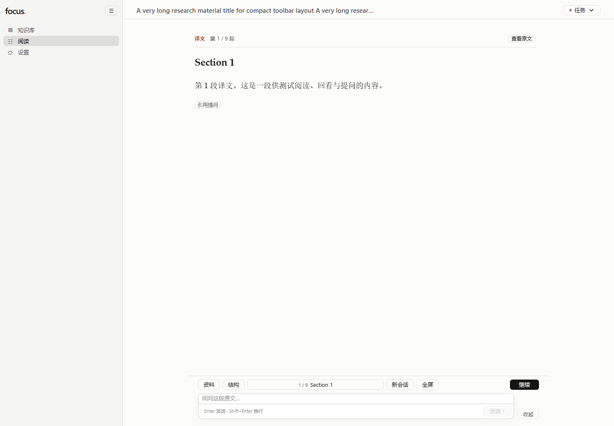
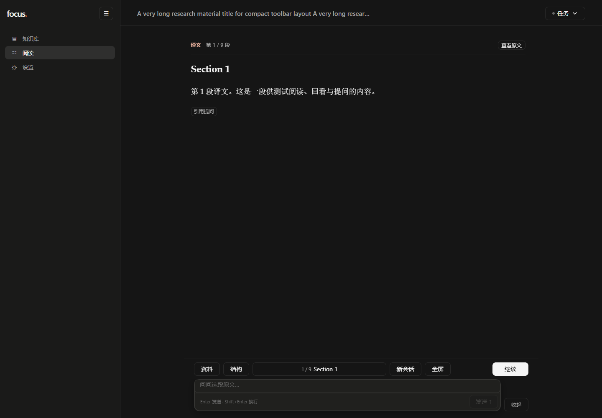
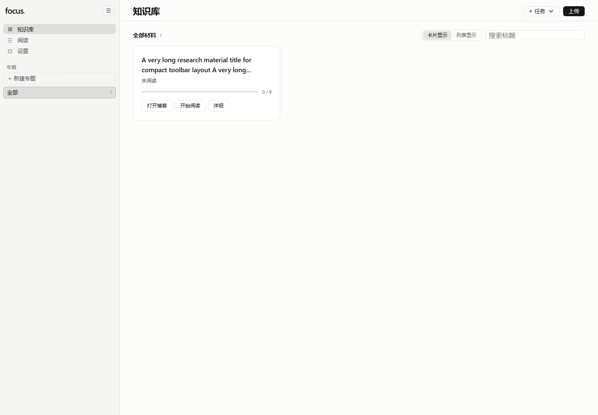
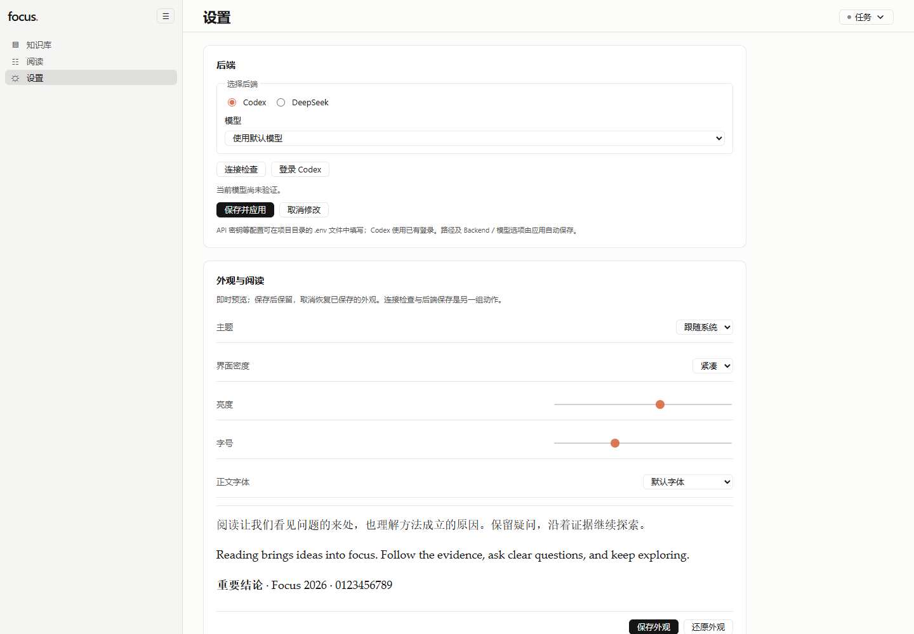

# FOCUS CDS presentation

> 当前适用范围与后续替代关系见[设计索引](README.md)。以下保留原始方案／实施记录及其当时状态。

Execution authority: 2026-10-18 user request; [ADR 0025](../adr/0025-cds-focus-presentation.md).
Selected design: [FOCUS_UI_CDS2_DESIGN_SPEC.md](FOCUS_UI_CDS2_DESIGN_SPEC.md) §4–§12.
Numbers: [focus-tokens.css](../../ui/packages/reader-ui/src/focus-tokens.css) — the only numeric authority.
Tracker: [spec](../../.scratch/focus-ui-refactor/spec.md), [issues](../../.scratch/focus-ui-refactor/issues).
Reference snapshot: [reference.json](../../.scratch/focus-ui-refactor/evidence/reference.json).

Mode `Integrate`, `visual_policy: redesign`. The scope decision in the prompt replaces the
Mist presentation; FOCUS data, ReaderHost, Cursor and recovery semantics are unchanged.

## Adopted target and product adaptations

| Spec area | Target | Implemented | Adaptation / evidence |
| --- | --- | --- | --- |
| §6.1 Surfaces | canvas #FCFCFB/#151515, surface-1, surface-2, popover | Semantic tokens; workbench nav = surface-1, content = canvas, cards/composer = surface-2 | No translucent Mist material; blur removed from prose, lists and inputs |
| §6.1 Accent | clay #d97757 | Clay for emphasis, icons and indicators | Text-sized clay uses `--reader-accent-ink` (#a8462a light / #e8b09c dark, ≥4.5:1); primary buttons use action ink with on-action text, per §6.1 accessibility rule |
| §6.1 Status | named danger/warning/success | `--reader-danger/warning/success` + tinted backgrounds | Clay no longer stands in for status |
| §6.3 Controls | 24/32 visible height, 6/8 radius | `--reader-control-h`, `--reader-radius` | Coarse pointers raise hit targets to 44px; inline controls use 18/22 |
| §6.3 Geometry | composer 12/14, card 10/12, dialog 16, bubble 18 | Token per role | Composer and cards share one border, no double ring |
| §6.3 Spacing | 6/8/12/20/32 compact; 8/12/16/28/40 comfortable | Same scale as `--reader-gap-*` | Density switch changes geometry only |
| §6.3 Type | UI 13/14, conversation 16/1.75, prose 18/1.9, 16–26 reading sizes | `--reader-ui-size`, `--reader-conversation-*`, `--reader-prose-*`; reading size still comes from the existing font-size preference | Source text keeps the serif role and user font; conversation uses UI sans |
| §5.1 Navigation | one 288px collapsible sidebar, topics inside it | `.workspace-nav` 288/56; Topics render in the sidebar from the same `topic` state | Removed the separate library Topic card so navigation is not duplicated |
| §5.2 Library (superseded by ADR 0027) | List + shared details panel; card switch retained | Single row action; docked/overlay/mobile panel; Topic counts/Unfiled/order; status filters, Continue Reading and ingestion projections | [ADR 0027](../adr/0027-library-list-and-details-panel.md), [acceptance](library-redesign-acceptance.md) and [evidence](evidence/library-redesign/07-regression.md); business semantics unchanged, browser verification blocked |
| §5.3 Reading | continuous canvas, 800px measure, actions before composer | `.focus-content` max 800 + 24 padding; actions row above composer | Reading card and assistant bubbles no longer close the prose |
| §5.3 Timeline | no dimming of history | Removed `--depth-opacity` and `mist-settle` replay | Only a newly appended event animates once (200ms, translateY 8px) |
| §5.3 Rail | structure/location in the function row | Removed the duplicate 86px reading rail; the location badge opens the paragraph list, structure keeps its own control | Unread paragraphs stay disabled; reviewing never moves the Cursor |
| §5.4 Composer | Editor + Notices + Chin | Notices above the box, reference/attachments inside the editor, chin holds hint, tools and send/stop | Stop stays available when the composer is collapsed (function row) |
| §5.5 Drawer | left overlay, four content types | 420px overlay anchored to the reading area; tabs 图片 / 笔记 / 进度 / 讨论 | Auto figure selection and left placement preserved; no reflow of the text column |
| §5.6 Feedback | real running state only | Task dot pulses only while a run is active; approval/stopping/unknown copy unchanged | Reduced motion stops the loop |
| §5.7 Settings | appearance, reading, backend, workspace | Appearance group has 保存外观 / 还原外观; backend keeps 保存并应用 / 取消修改; connection check separate | Preferences keep the existing storage keys |
| §6.2 Elevation | one ring + diffusion shadows | `--reader-shadow`, `--reader-shadow-hover`, `--reader-shadow-popover` | Focus also uses a visible outline, not shadow alone |
| §7 Motion | 60/120/200/300/450ms, three curves | Token times; CSS transitions and one explicit presence animation with no timers | Reduced motion disables movement; business actions never wait for animation |
| §7.3 Scroll | Continue positioning separate from streaming follow | Existing `settle()` and follow flags retained untouched | The visual change did not replace the scroll model |

## Deliberate deviations

1. **Visible control height** follows §6.3 (24/32) rather than the earlier interim 32/40.
   Browser checks at 1440px showed no CJK clipping at 24px; hit targets expand on coarse pointers.
2. **Clay text** is darkened only where the copy is text-sized, as §6.1 explicitly allows.
   Clay itself stays the brand accent for icons, indicators and focus.
3. **Brightness preference** now filters the reading surface instead of the whole application,
   so dialogs and navigation keep their contrast; the stored key and range are unchanged.
4. **The appended override layer** (`focus-workbench.css`) was deleted and its intent folded into
   the owning `standalone.css`, per §3.3 instruction not to keep appending end-of-file overrides.
5. **Optional enhancements not adopted**: 1.32 pill confirmation, shared-element image transitions,
   skeleton choreography. The image viewer keeps its native top-layer dialog and direct open/close.
6. **Blog viewer** covers shell, title, close and external open only; generated HTML stays as-is (P7).

## Reference alignment limits

The local reference is `external/open-claude-ui` at `ddf3aea1711db62fd6d24343bbab500a5ae69f64`
(clean). The selected proposal was written against `02d021fc…`; the drift was reviewed for the
files actually adopted (theme CSS, motion presets, v2 chapters 3–4) and did not change the
decisions above. Reference claims about official internals or performance remain upstream claims.
No reference code, font or asset is imported at runtime; no `external/` path appears in the build.

## Screenshots

The Library image below is the historical CDS presentation, not evidence for the 2026-10-20 Library redesign. New screenshots were waived by the user; see the [Library acceptance record](library-redesign-acceptance.md) for functional evidence and explicit browser limitations. No replacement screenshot is claimed.

Fixed synthetic workspaces served by the isolated Host, 1440×1000, Edge/Chromium.

| Reading (light, compact) | Reading (dark, comfortable) |
| --- | --- |
|  |  |

| Library | Settings |
| --- | --- |
|  |  |

## Verification

| Check | Result | Evidence |
| --- | --- | --- |
| `pnpm reader:typecheck` | PASS | three packages, no diagnostics |
| `pnpm reader:test` | PASS | reader-ui 67/67, standalone 90/90 (Node 25 needs `NODE_OPTIONS=--no-experimental-webstorage` so jsdom owns Web Storage; repository config unchanged) |
| `pnpm reader:build` | PASS | CSS 112.7kB → 91.1kB after consolidation |
| Fixture browser matrix | PASS (screenshots + assertions) | 1440 desktop, 1440×1000, 1280×720 short, 390 narrow, 768 tablet, light/dark, compact/comfortable, drawer, fullscreen; assertions: drawer overlays without reflow and closes with Escape, fullscreen keeps Continue reachable, dark+comfortable applied from settings, 390px has no horizontal overflow |
| Isolated Host UX suite | PASS | `tests/confirmed_ux_browser.mjs` (10 groups) and `tests/reader_figures_browser.mjs` (6 groups) migrated to the function row, four-tab drawer and overflow menu; run against the isolated Host with `PYTHONUTF8=1` (the fixture server otherwise decodes UTF-8 workspaces as GBK on Chinese Windows) |
| Native IME / assistive tech | NOT_RUN | no native input-method session available here |
| Browser harness | PASS | both suites load Playwright through `createRequire`, so an absolute module path works on Windows |
